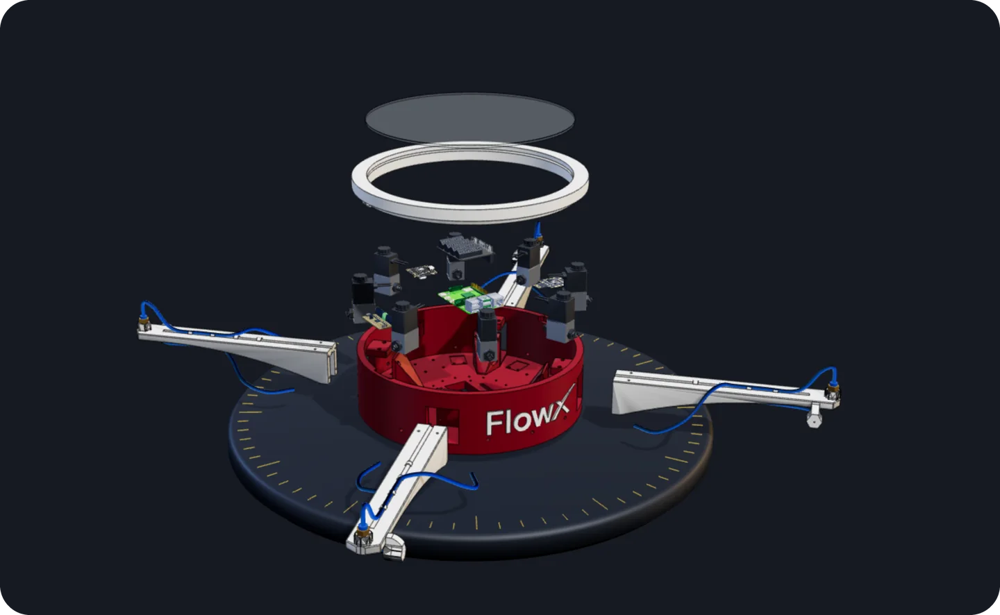
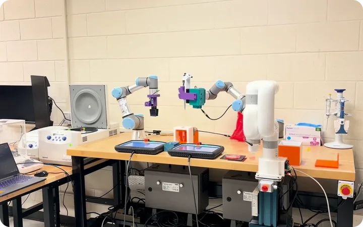
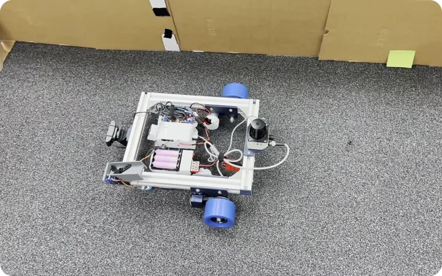
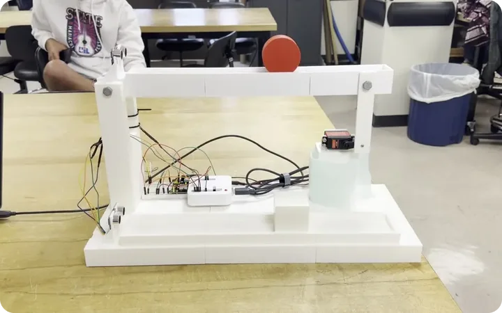

<h1 align="center">Vedansh Shah</h1>

Robotics engineer and master's student at Texas A&amp;M

  <picture>
    <source media="(prefers-color-scheme: dark)" srcset="https://readme-typing-svg.demolab.com?font=Fira+Code&pause=1200&color=F5B324&center=true&vCenter=true&width=650&lines=M.S.+student%2C+Texas+A%26M;Two+UR3e+arms+doing+wet-lab+work;A+drone+that+flies+without+propellers;Open+to+robotics+internships+for+summer+2027"/>
    
  </picture>

  
   
  <a href="https://vedashahportfolio.netlify.app/flowx"><b>Fly this drone in your browser</b></a>

  <a href="https://vedashahportfolio.netlify.app/">Portfolio</a> &nbsp;&nbsp;&nbsp;
  <a href="https://vedashahportfolio.netlify.app/assets/Vedansh_Shah_Resume.pdf">Resume</a> &nbsp;&nbsp;&nbsp;
  <a href="https://www.linkedin.com/in/vedansh2004">LinkedIn</a> &nbsp;&nbsp;&nbsp;
  <a href="mailto:vedansh.shah@gmail.com">Email</a>

### About me

I'm a grad student at Texas A&M working on robots. My B.S. is in Mechatronics Engineering, also from here, and I finished it in May 2026.

I'm a researcher in Dr. Kiju Lee's SynBio Automation Lab. I write the ROS2 and MoveIt2 code that runs two UR3e arms through wet-lab work, and I design the tools on the ends of the arms.

I also teach three lab sections of Mechatronics I, 42 students total. They start with a Raspberry Pi robot that doesn't do anything yet, and by the end it follows a target with its camera.

I want a robotics internship or co-op for summer 2027.

I'm also into speedcubing and 3D printing, and I build animatronic eyes for fun.

### FlowX, the project I'm proudest of

My senior capstone was a drone that runs on cold gas instead of propellers. It's meant for the Moon, where there's no air to push on. I led software and CAD on a team of six.

We started with a normal propeller drone to get the code working. Then we built the thruster drone and a 3-axis rig to test it on. Both drones run our own Python code on a Raspberry Pi 4.

- 26,917 load-cell counts of thrust (the design range was 17,000 to 25,000)
- 25 of 25 tests passed, and all 28 functional requirements met
- Rotates &plusmn;150&deg; in pitch, roll and yaw
- Eight solenoid valves on an MCP23017, with SBUS radio input
- Code: [github.com/vedashah/FlowX](https://github.com/vedashah/FlowX)

### Other projects

<table>
  <tr>
    <td width="33%" valign="top">
       
      <a href="https://vedashahportfolio.netlify.app/synbio"><b>Lab automation with two UR3e arms</b></a> 
      One UR3e works the centrifuge while the other pipettes. The pipette tool and the tube handler are mine.
    </td>
    <td width="33%" valign="top">
       
      <a href="https://vedashahportfolio.netlify.app/facility-inspection-robot"><b>Facility inspection robot</b></a> 
      It gets around a course with LIDAR and uses OpenCV to find the green targets. Built with a partner.
    </td>
    <td width="33%" valign="top">
       
      <a href="https://vedashahportfolio.netlify.app/additional-work"><b>Ball and beam</b></a> 
      You slide a block and the beam tilts until the cart lines up with it. It took us three weeks.
    </td>
  </tr>
</table>

I was on Aggie VEX Robotics for a year, doing wiring and Python. We won the VEX U state tournament and came 12th at Worlds.

### Tools

<a href="https://www.ros.org/"><picture><source media="(prefers-color-scheme: dark)" srcset="https://cdn.simpleicons.org/ros/8FB4E3"/></picture></a>

<a href="https://www.autodesk.com/products/fusion-360/"><picture><source media="(prefers-color-scheme: dark)" srcset="https://cdn.simpleicons.org/autodesk/FFFFFF"/></picture></a>

### Contact

Email: **vedansh.shah@gmail.com** 
LinkedIn: [linkedin.com/in/vedansh2004](https://www.linkedin.com/in/vedansh2004)

---

  
  

  

